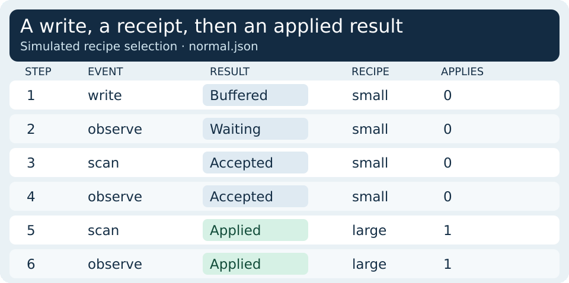
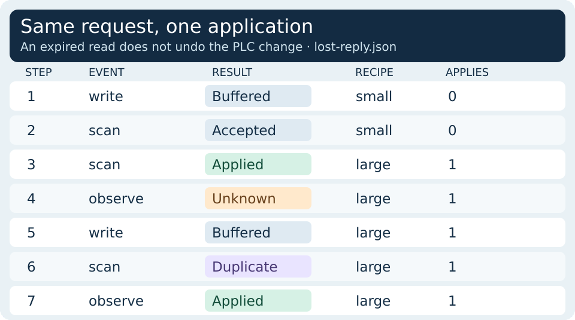

# PLC HMI Command Handshake Lab

Use a small Python simulator to follow an HMI recipe selection from a buffered write to a PLC receipt and then a terminal result. The example writes a mock value in memory. It cannot communicate with a PLC, HMI, OPC UA server, or machine.

Full lesson: [PLC HMI Integration: A Command Handshake Lab](https://wifarobotics.com/learn/plc-hmi-integration/).

## Start from zero

1. Install [Python 3.12 or later](https://www.python.org/downloads/). Verify it with `python --version`; on macOS and Linux use `python3` if needed, and on Windows try `py -3`.
2. On this GitHub page choose **Code → Download ZIP**. Extract it and open a terminal in the folder containing `handshake.py`. If you already have Git, you can clone instead:

   ```sh
   git clone https://github.com/williamfarokhzad/wifa-plc-hmi-integration.git
   cd wifa-plc-hmi-integration
   ```

3. Run the examples and tests. The simulator has no third party dependencies. Substitute your Python command if needed.

   ```sh
   python handshake.py examples/normal.json
   python handshake.py examples/lost-reply.json
   python handshake.py examples/restart.json
   python handshake.py examples/rejected.json
   python -m unittest discover -s tests -v
   ```

## Read the trace

| Example | Decisive output | Final recipe and apply count |
| --- | --- | --- |
| Normal | `buffered → accepted → applied` | `large`, 1 |
| Lost reply | The expired read is `unknown`. Replay of the same envelope is `duplicate`. A fresh read finds `applied`. | `large`, 1 |
| Restart | Old command scan is `wrong_epoch`. HMI read says `reconcile`. | `large`, 1 |
| Rejected | The receipt says `accepted` before the PLC produces `rejected`. | `small`, 0 |

The `applies` column counts mock applications since process start. A request carries `epoch`, `seq` and `recipe`. The controller accepts a new sequence after it consumes the mailbox. A following scan validates the recipe. In this lab only `small` and `large` are allowed.





## Try one change

Copy `examples/restart.json` to `examples/before-apply.json` and remove the **second** scan before the restart. The remaining scan has only accepted the request. Run `python handshake.py examples/before-apply.json`. The final result is still `reconcile`, but the mock recipe is now `small` and the apply count is zero. The HMI cannot infer either outcome from a restart message alone.

## Troubleshooting

- **No module named handshake:** Run the tests from the directory that contains `handshake.py`.
- **File not found:** Change to the extracted project folder and check that the scenario path starts with `examples/`.
- **Mailbox occupied:** Keep the same envelope for a replay. This simulator accepts just one unconsumed envelope.
- **A write returns buffered but nothing changes:** Add two `scan` events. The first latches the envelope and the next completes it. `observe` is a read and does not advance the scan.
- **Unknown or reconcile:** Read the current controller identity, latest receipt and actual process state. Do not translate uncertainty into an automatic new command.

## Scope and files

`handshake.py` models single ownership, a coherent mailbox and fresh reads. Its epoch counter exists only in one Python process; a real system needs a reliable nonrepeating session identifier across restarts. There is no real network, timing model, independent hardware readback, durable audit trail or multi-client arbitration. This is not a machinery safety function, PLC program or permission model.

The four JSON examples drive the CLI. The tests cover the status transitions and check seeded retries and old packets against a set of commands expected to apply. The two SVGs in `diagrams/` are editable. To regenerate both formats, install Inkscape and run `python -m pip install Pillow` followed by `python diagrams/render.py`.

Primary reading: [Siemens PLC and HMI handshake](https://docs.tia.siemens.cloud/r/en-us/v3.0/automation-framework/automation-framework-v3.0/3.-overview/3.4.-plc-software/3.4.10.-software-design-principles/3.4.10.3.-plc-hmi-handshake?contentId=UGezD4lIkI8dS5dp6ZvKpw), [Beckhoff HMI handshake signals](https://infosys.beckhoff.com/content/1033/tf8550_plastic_hmi_framework/13187556747.html), and [OPC UA Write service](https://reference.opcfoundation.org/specs/OPC-10000-4/5.11.4). They illustrate vendor and transport behaviors. The Python envelope and event order are original teaching choices.
